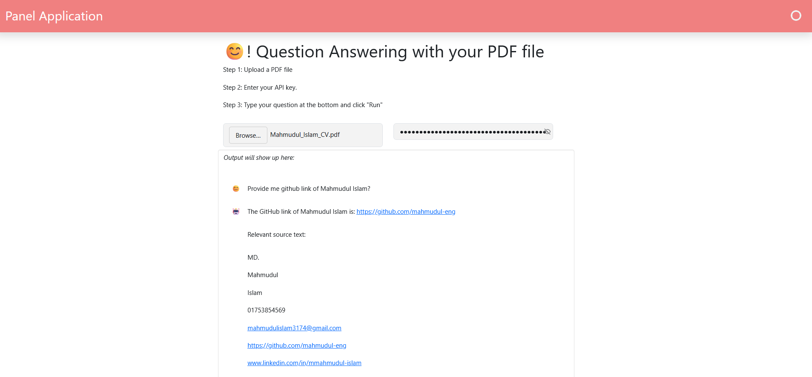

# LangChain QA Panel App (Modernized, Free Version)

Ask questions about any PDF using a Panel web UI, RAG, and Gemini.

*Asking a question about a PDF in the Panel app*

## Credits
Original app by Sophia Yang: <https://github.com/sophiamyang/tutorials-LangChain>.
This version is adapted from it. The original license is kept in this repo.

## What I changed
- Migrated from LangChain 0.0.x to current LangChain
- Replaced OpenAI with the free Google Gemini API
- Replaced OpenAI embeddings with local sentence-transformers embeddings
- Added caching so each PDF is embedded once
- Default chain type set to "stuff" to save API calls

## How it works
PDF -> split into chunks -> embed (sentence-transformers) -> store in Chroma
-> retrieve top-k chunks -> Gemini answers using those chunks.

## Run
pip install -r requirements.txt
panel serve LangChain_QA_Panel_App.ipynb --show
Then upload a PDF, paste your Gemini key, and ask a question.
Get a free key at https://aistudio.google.com/apikey

## Notes
Your API key is entered in the UI and never stored in the code.